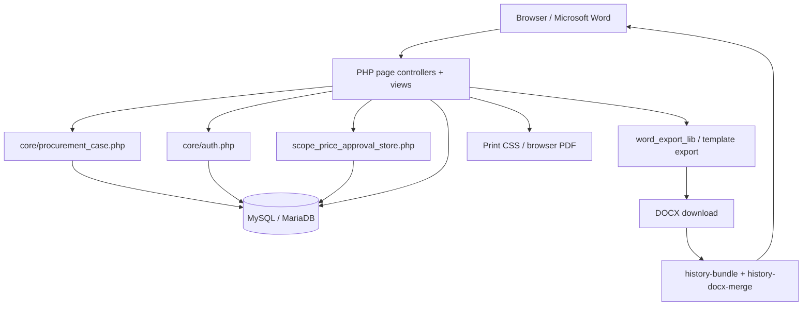

# Architecture — v1.1.0

## รูปแบบระบบ

Server-rendered PHP แต่ละหน้ารับ GET เพื่อโหลดข้อมูล/ฟอร์ม และ POST เพื่อบันทึก/สร้างรายงานตาม action; PHP ติดต่อ MySQL ผ่าน `db()` ใน core/config.php. มี HTML/CSS/JS ในไฟล์หน้าเองและ shared assets. ไม่ใช่ Laravel, SPA, Node backend หรือ REST API เต็มรูปแบบ. ไม่ควร include หน้า PHP หลายหน้าใน request เดียว (มี helper ชื่อซ้ำและ output/exit ของตัวเอง).

## หน้า PHP และหน้าที่

| Path | หน้าที่ / จุดเริ่มอ่าน |
|---|---|
| `index.php` | หน้าหลักและลำดับ workflow 6 ขั้น; navigation เข้าชุดงาน |
| `login.php` | login, ตรวจ password/status/throttle, session และ redirect |
| `register.php` | สมัครสมาชิก pending, validate username/password, admin อนุมัติก่อนใช้ |
| `logout.php` | ออกจาก session; รักษาเส้นทางและความปลอดภัยเดิม |
| `change_password.php` | บัญชีของตนเอง, เปลี่ยนรหัสผ่าน, admin จัดการผู้ใช้และสถานะ; ตรวจ self-action/role |
| `admin.php` | จัดการรายการยา, ราคากลาง, ค่าเริ่มต้นผู้ลงนาม, CSV/XLSX import/export ตัวอย่าง, progress และ live search `live_medicines`/`live_prices`; requireAdmin |
| `principle_approval_memo.php` | สร้าง/แก้ชุด case, บริษัท, รายการยา, คณะกรรมการและข้อมูลหลักการ; ส่งออก native DOCX; จุดเริ่มของ workflow |
| `committee_scope_invitation.php` | เชิญกรรมการ/ระเบียบวาระจาก case; บันทึก document แยก; native DOCX |
| `tor_company_purchase.php` | ฟอร์มยา ราคา ขนาดบรรจุ งบ/กรรมการ, `reportItems()`, `reportHtml()`, `saveTorHistory()`, `updateTorHistory()`; `save_report`, `report`, `word`, `save_draft` และฟังก์ชันชุดกรรมการ |
| `scope_price_approval_memo.php` | อนุมัติใช้คุณลักษณะและราคากลาง; ใช้ store เฉพาะ, template export; อ่าน case/เอกสารที่เกี่ยวข้อง |
| `committee_scope_result_memo.php` | รายงานผลพิจารณา; อ่าน case, invitation, TOR history, meeting เดิม; `committeeResultDocumentHtml()`, `committeeResultWordCss()`, action `word_document` |
| `meeting_report.php` | รายงานประชุม, บก.06 และรายละเอียดแนบท้าย; history snapshot, กรรมการ, เนื้อหาการประชุม; `meetingReportDocumentPages()`, `meetingReportWordHtml()` |
| `document_history.php` | รายการ case, completion, ค้นหา/กรอง, เปิดรายหัวข้อ, ลบตามสิทธิ์เดิม, ปุ่มรวม Word ราย case |
| `case_word_merge.php` | POST `bundle_action=prepare`, session+CSRF, ตรวจ case และครบ 6 ขั้น, คืน JSON filename เท่านั้น ไม่รับ DOCX upload/ไม่เขียน DB |
| `word_export.php` | endpoint Word เดิมที่ใช้ร่วมกับ client exporter; อ่าน contract ก่อนแก้ |

## Shared PHP

| Path | Contract |
|---|---|
| `core/config.php` | PDO connection, environment vars, `requireDatabaseTables()` ตรวจมี table ไม่ตรวจ columns |
| `core/auth.php` | `currentUser`, `requireLogin`, `requireAdmin`, `csrfToken`, `verifyCsrf`, password policy, throttling, audit, headers/session |
| `core/procurement_case.php` | CRUD case, decode JSON, document upsert, completion, delete/reset (destructive; ไม่เรียกใน QA) |
| `core/document_filename.php` | แปลงเลข/วันที่ พ.ศ., sanitize, ตัดชื่อบริษัท, `torDocumentFilename`, `torCaseSupplierLabel` |
| `core/document_signer_defaults.php` | load/save ค่าเริ่มต้นผู้เสนอ/ผู้อนุมัติของหลักการ |
| `core/scope_price_approval_store.php` | `scopePriceApprovalInstalled/Load/Exists/Save/Delete`, ข้อมูลแยกเฉพาะขั้น 4 |
| `core/scope_price_template_export.php` | template field mapping, XML logical paragraphs, output native Word ขั้น 4 |
| `core/scope_price_thai_breaker.php` + `core/scope_price_thai_words.txt` | ตัดคำ/จุดขึ้นบรรทัดภาษาไทยสำหรับ scope; ห้ามนำไปแทนข้อความทุกหน้าทั้งหมด |
| `core/word_export_lib.php` | Word profiles, font embed, HTML clean/inline images, DOCX patch, native templates, HTML altChunk fallback/output; อ่าน WORD_EXPORT |
| `components/navbar.php` | เมนูร่วมตาม login/role |
| `components/workflow_steps.php` | สถานะและลำดับ 6 ขั้น; ต้องตรงกับ index/history |

## Assets และ resource

`assets/app-theme.css` ธีมหลัก; `auth-pages.css` login/register; `backoffice-blue.css` หลังบ้าน/บัญชี; `admin-compact.css` admin; `home-blue.css` หน้าหลัก; `history-blue.css` ประวัติ/ปุ่มรวม; `nav-blue.css` navbar. `document-workspace.css/.js` screen-only workspace/fit/scroll; `tor-document-print-name.js` ตั้งชื่อ PDF ที่ browser อาจใช้; `assets/js/word_export.js` client export เดิม; `history-bundle.js` ดึง Word 6 หัวข้อ; `history-docx-merge.js` ผสาน ZIP/OOXML ใน browser. `picture/picture-1.png` ตราครุฑ; `assets/fonts/` ฟอนต์ฝัง; `templates/docx/` แม่แบบ 3 ฉบับ. `tools/build_docx_templates.php` เครื่องมือสร้างแม่แบบ ไม่ควรรันเพื่อแก้ format โดยไม่เก็บต้นฉบับ. `storage/tmp/` พื้นที่ชั่วคราว; `.htaccess` ป้องกัน directory listing / sensitive files. `composer.json/lock` dependency; `database/` schema/migrations/dumps (ดู DATABASE/SECURITY). รายการทุก path ใน REPOSITORY_INVENTORY.

## อ่านตามประเภทงาน

- ข้อมูล TOR → tor_company_purchase.php + procurement_case.php + history-bundle.js + report/meeting consumers
- เปลี่ยนลำดับ workflow → index, workflow_steps, history, bundle order, filename step mapping (ห้ามแก้ DB keys)
- เปลี่ยน Word รูปแบบ → หน้าเฉพาะ + word_export_lib หรือ scope template + merge code + print CSS
- เปลี่ยนบัญชี → auth/login/register/change_password + migration; admin ไม่ใช่ account hub
- เปลี่ยน UI → หน้าและ shared CSS/JS เฉพาะงาน; ห้ามแก้ print CSS โดยไม่ตั้งใจ
