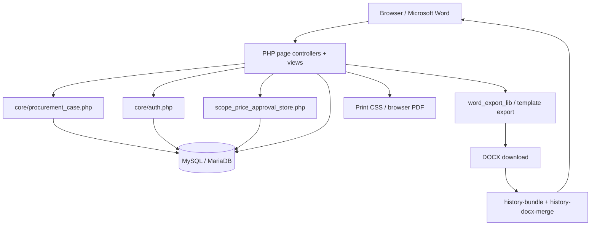

# Architecture — Admin Workspace v1.4.0

**26 พฤศจิกายน 2569 — Git runtime baseline v1.4.0**

Repository: `TonChaiya/torskp.page.gd` · branch `main` · runtime commit [`c4699b22`](https://github.com/TonChaiya/torskp.page.gd/commit/c4699b22bbb58e563d4983f4fec9e0c119d97164).

- ผู้ใช้ Push แล้วเวลา 09:43:38 ICT (commit timestamp); ข้อความ commit `v1.4.0` / `feat(admin): redesign workspace and add committee management`. ตรวจ Git blob ตรงกับ ZIP Hotfix C ทั้ง 7 ไฟล์. รุ่นนี้เป็น source baseline ไม่ใช่ Git tag หรือการยืนยัน deploy.
- ผู้ใช้ตอบรับการแก้ UI ล่าสุดและอนุญาต Push; ยังไม่มีการยืนยันการอัปโหลด v1.4.0 ขึ้น InfinityFree หรือ UAT ครบทุกฟังก์ชันบน MySQL/Word จริง. v1.3.0 เป็น Production baseline ล่าสุดที่มีบันทึกยืนยันชัดเจน (25 พ.ย. 2569); ไม่อนุมานว่า Hosting ยังอยู่รุ่นใดในปัจจุบัน.
- Git baseline มีโค้ด hotfix v1.3.1 ของหลักการและรายงานประชุมอยู่แล้ว; ตรวจพบ `core/meeting_tor_refresh.php` และ renderer ใน `meeting_report.php` ที่รองรับ `price_basis`. ไม่ย้อนกลับไปใช้สูตรราคาเสนออย่างเดียว หรือเริ่มงานที่ปิดแล้วซ้ำโดยไม่มีปัญหาใหม่.
- เอกสารรอบนี้เป็น docs-only handoff ยังไม่ Push จากผู้ช่วย; HEAD จะเปลี่ยนเมื่อผู้ใช้ commit เอกสาร แต่ runtime baseline ข้างต้นยังเดิม. ไม่เปลี่ยน PHP/JS/CSS, SQL, template, DB หรือ Hosting.

## Delta ของโครงสร้าง (ไม่เปลี่ยน framework)

| Path | Contract ปัจจุบัน |
|---|---|
| `admin.php` | Server-rendered markup/CRUD, requireAdmin/POST CSRF, catalog/search/import/export/clear/signer defaults เดิม; blob ไม่เปลี่ยน |
| `assets/admin-modal.js` | Controller เดิม + workspace enhancement, ย้าย DOM จริงเข้า dialog, committee UI, deep links และ fallback |
| `assets/admin-compact.css` | CSS จาก head; first paint width/padding คงที่และยุบ grid ระหว่าง JS เตรียม UI |
| `assets/admin-workspace.css` | Scoped layout 2 กลุ่ม 4 เมนู, dialog body scroll, toolbar/table/form styles |
| `admin_committee.php` | Admin-only JSON สำหรับ list/create/update/delete ต้นแบบ; requireAdmin/CSRF, transaction/fingerprint/duplicate-title/FK guard/audit |
| `committee_sets` | ตารางเดิม ประธาน 1 กรรมการ 2; ใช้ร่วมหน้า principle; ไม่อ้างเป็นตาราง case document |
| `core/document_signer_defaults.php` | unchanged; load/save ค่าเริ่มต้นหัวข้อ 1 |

ข้อมูลยา/ราคาใช้ routes และ core/import/snapshot เดิม. `change_password.php` ยังเป็น account center. ไม่เพิ่ม service/worker/schema; workflow 6 ขั้นและ merge V4 คงเดิม. `core/meeting_tor_refresh.php` ของ hotfix ก่อนหน้ายังอยู่ Git และคง price_basis/case isolation/fingerprint; ไม่แก้ใน v1.4.0.

รายละเอียด: [Admin Workspace](ADMIN_WORKSPACE_20261126.md) · [Hotfix B](ADMIN_WORKSPACE_HOTFIX_20261126.md) · [Hotfix C / First Paint](ADMIN_WORKSPACE_FIRST_PAINT_20261126c.md).

---

> **ประวัติเดิม (เก็บครบตาม Git blob ก่อนปรับ v1.4.0):** ข้อมูลเวอร์ชัน, HEAD, สถานะ candidate, คำว่า "ปัจจุบัน" และคำสั่ง release ในเนื้อหาด้านล่างอ้างอิงช่วงเวลาที่เขียน ไม่ใช่สถานะล่าสุด ให้ยึดส่วน v1.4.0 ด้านบนและ PROJECT_STATUS เป็นหลักสำหรับสถานะ; ข้อกำหนดทางเทคนิคเดิมยังมีผลเว้นแต่มีการแก้ไขชัดเจนในส่วนใหม่.

# v1.3.1 — Meeting price refresh correction

**25 พฤศจิกายน 2569 — v1.3.1 follow-up: Meeting TOR price basis (candidate)**

ผู้ใช้พบว่ากดดึง TOR ล่าสุดแล้วราคายังไม่เปลี่ยน. ตรวจพบ renderer เดิมอ่าน `offer_price`/`offer_total` เท่านั้น แม้ TOR ใช้ `price_basis=reference` เป็นค่าเริ่มต้น. ข้อความด้านล่างที่ระบุคงสูตรราคาเสนอจึงเป็นประวัติของ hotfix ก่อนหน้า ไม่ใช่สัญญาปัจจุบัน.

- เมื่อ refresh หรือสร้างรายงานจาก TOR ที่เชื่อมกับหัวข้อ 3 ใช้ `price_basis` จาก extra ของ TOR ที่บันทึก: `reference` (ค่าเริ่มต้น) แสดง `reference_price` และคำนวณจำนวนที่ใช้คิดราคา × ราคากลาง; `offer` ใช้ราคาเสนอและยอดตามสูตรเดิม. กรณีบรรจุกล่องใช้ package_count ไม่ใช่ requested_quantity. ตารางแนบท้าย 2, ยอดรวม, จำนวนเงินตัวอักษรและ HTML สำหรับ Word ใช้ฐานราคาเดียวกัน. ประวัติอื่นที่ผู้ใช้เลือกเองและไม่มี metadata ของโหมดราคาคง fallback ราคาเสนอเดิม.
- เมื่อผู้ใช้กดบันทึกรายงาน เก็บ `price_basis` และทั้งสองราคาใน extra_json เดิม. รายงานเดิมที่ไม่มี `price_basis` และมี snapshot ที่สมบูรณ์ยังใช้ราคาเสนอเหมือนเดิม จนกว่าจะกดดึงแล้วบันทึกเอง. ไม่แก้ประวัติ TOR/ข้อความที่พิมพ์เอง/รายชื่อกรรมการ/วันเวลา ไม่บันทึกตอน refresh. Fingerprint ครอบคลุมฐานราคา จึงป้องกันกรณี TOR เปลี่ยนเฉพาะโหมดก่อน Save/Word. แสดงฐานราคาและยอดรวมหลัง refresh ให้ตรวจสอบก่อนบันทึก.
- ไม่มี SQL migration; ไม่มีการเปลี่ยน TOR, Import, Word Merge V4 หรือหน้าที่ไม่เกี่ยวข้อง. ใช้ ZIP สะสมแทนชุด v1.3.1 ก่อนหน้า; Git HEAD ก่อนแก้ยัง `7aec524d106b1c4a61653fa4c9d518a6d07d7c07`. Runtime 3 ไฟล์เหมือนชุดก่อน (หน้าหลักการคงเดิมจาก hotfix ก่อน, แก้เพิ่มเฉพาะ meeting_report.php และ core/meeting_tor_refresh.php).
- QA: PHP lint; helper 30 checks; integration PHP/ฐานจำลองเดิม 15 checks + 11 checks เฉพาะราคา (เปลี่ยนเฉพาะราคากลาง, ID เดิม/ใหม่, package, ทั้งสองโหมด, stale basis/reference, Save, reload, Word HTML, legacy snapshot). Chromium offline DOM ทดสอบกดปุ่มจริงและ FormData 2 checks ผ่าน; นำ payload ไปประมวล PHP mock และ render ผล ไม่ใช่ HTTP end-to-end เพราะ sandbox บล็อก navigation. ยังไม่ทดสอบ MySQL, InfinityFree หรือ Word Desktop จริง. UAT: บันทึก TOR ราคากลางใหม่โดยไม่แก้ราคาเสนอ แล้วกดดึงรายงานเดิม ตรวจตารางที่ 2 และยอดรวม กดบันทึกเอง เปิดใหม่ และตรวจ Word.

---

# v1.3.1 — Maintenance hotfix

**25 พฤศจิกายน 2569 — v1.3.1 Hotfix (candidate):** v1.3.0 ยังเป็น Production baseline ที่ผู้ใช้ยืนยัน; Git HEAD ก่อนแก้ `7aec524d106b1c4a61653fa4c9d518a6d07d7c07` เป็น docs closure ที่ Push แล้ว. ผู้ใช้รายงานสองปัญหาหลังขึ้น Production และอนุมัติแก้เฉพาะจุด. Hotfix ยังไม่ได้ Push หรือ deploy และรอผู้ใช้ทดสอบ Dev/Production. ไม่มี migration. ข้อมูลประวัติเดิมด้านล่างคงอยู่ครบ.

เพิ่ม `core/meeting_tor_refresh.php` สำหรับ validation รายการ, case isolation, fingerprint และข้อความจำนวนยา. Handler และ render อยู่หน้าเดิม; ไม่เพิ่ม API/worker/schema.

---

# บันทึกสถานะปัจจุบัน — v1.3.0

**สถานะล่าสุด 25 พฤศจิกายน 2569 (ปิดงาน v1.3.0):** ผู้ใช้ยืนยันว่า Dev ใช้งานได้ และอัปโหลดขึ้น InfinityFree ใช้งานจริงได้หมดแล้ว (12:56 น. ICT). กำหนด v1.3.0 เป็น stable maintenance baseline ตามการยืนยันของผู้ใช้; ไม่ใช่ผลรับรอง independent UAT หรือ security audit. ข้อความ Candidate/รอ Push/รอ Production ในเนื้อหาเดิมด้านล่างเป็นบันทึกตามเวลาที่เขียน ไม่ใช่งานค้างปัจจุบัน. ข้อกำหนดทางเทคนิคและข้อจำกัดการทดสอบเดิมยังคงมีผล.

อ่าน [สถานะ canonical](PROJECT_STATUS.md) สำหรับงานคงเหลือและขอบเขตหลักฐาน.

### โครงสร้างที่ใช้งานอยู่ v1.3.0
Source baseline `f30c93cf`. โครงสร้าง PHP หน้าเดิม + PDO + JS/CSS + PHPWord/mPDF ไม่เปลี่ยน framework. Import runtime ใน `core/catalog_import.php`, `core/spreadsheet_import.php`, `core/medicine_import.php`, `core/price_reference_import.php`; export/clear `core/medicine_catalog_tools.php`. Snapshot audit/resolution/backfill `core/document_snapshot.php` + `catalog_snapshot_review.php`; principle/TOR/history bundle ใช้ archive keys และ case/history ownership. `assets/history-docx-merge.js` กับ `core/word_export_lib.php` คง engine เดิม. ข้อความ architecture v1.1 และ candidate ด้านล่างอธิบายวิวัฒนาการ; ดู [DOCUMENT_SNAPSHOT](DOCUMENT_SNAPSHOT.md) และ [IMPORT_SYSTEM](IMPORT_SYSTEM.md) เป็น contract ล่าสุด. ไม่เพิ่ม services หรือ DB tables.

---

> **เอกสารต้นฉบับ / ประวัติการพัฒนา:** เนื้อหาต่อจากนี้เก็บครบตาม Git baseline; กฎปัจจุบันด้านบนใช้เฉพาะเมื่อแก้สถานะหรือชี้แจงความขัดแย้ง ไม่ยกเลิกข้อกำหนดทางเทคนิคเดิม.

# Architecture — v1.1.0

## รูปแบบระบบ

Server-rendered PHP แต่ละหน้ารับ GET เพื่อโหลดข้อมูล/ฟอร์ม และ POST เพื่อบันทึก/สร้างรายงานตาม action; PHP ติดต่อ MySQL ผ่าน `db()` ใน core/config.php. มี HTML/CSS/JS ในไฟล์หน้าเองและ shared assets. ไม่ใช่ Laravel, SPA, Node backend หรือ REST API เต็มรูปแบบ. ไม่ควร include หน้า PHP หลายหน้าใน request เดียว (มี helper ชื่อซ้ำและ output/exit ของตัวเอง).

## หน้า PHP และหน้าที่

| Path | หน้าที่ / จุดเริ่มอ่าน |
|---|---|
| `index.php` | หน้าหลักและลำดับ workflow 6 ขั้น; navigation เข้าชุดงาน |
| `login.php` | login, ตรวจ password/status/throttle, session และ redirect |
| `register.php` | สมัครสมาชิก pending, validate username/password, admin อนุมัติก่อนใช้ |
| `logout.php` | ออกจาก session; รักษาเส้นทางและความปลอดภัยเดิม |
| `change_password.php` | บัญชีของตนเอง, เปลี่ยนรหัสผ่าน, admin จัดการผู้ใช้และสถานะ; ตรวจ self-action/role |
| `admin.php` | จัดการรายการยา, ราคากลาง, ค่าเริ่มต้นผู้ลงนาม, CSV/XLSX import/export ตัวอย่าง, progress และ live search `live_medicines`/`live_prices`; requireAdmin |
| `principle_approval_memo.php` | สร้าง/แก้ชุด case, บริษัท, รายการยา, คณะกรรมการและข้อมูลหลักการ; ส่งออก native DOCX; จุดเริ่มของ workflow |
| `committee_scope_invitation.php` | เชิญกรรมการ/ระเบียบวาระจาก case; บันทึก document แยก; native DOCX |
| `tor_company_purchase.php` | ฟอร์มยา ราคา ขนาดบรรจุ งบ/กรรมการ, `reportItems()`, `reportHtml()`, `saveTorHistory()`, `updateTorHistory()`; `save_report`, `report`, `word`, `save_draft` และฟังก์ชันชุดกรรมการ |
| `scope_price_approval_memo.php` | อนุมัติใช้คุณลักษณะและราคากลาง; ใช้ store เฉพาะ, template export; อ่าน case/เอกสารที่เกี่ยวข้อง |
| `committee_scope_result_memo.php` | รายงานผลพิจารณา; อ่าน case, invitation, TOR history, meeting เดิม; `committeeResultDocumentHtml()`, `committeeResultWordCss()`, action `word_document` |
| `meeting_report.php` | รายงานประชุม, บก.06 และรายละเอียดแนบท้าย; history snapshot, กรรมการ, เนื้อหาการประชุม; `meetingReportDocumentPages()`, `meetingReportWordHtml()` |
| `document_history.php` | รายการ case, completion, ค้นหา/กรอง, เปิดรายหัวข้อ, ลบตามสิทธิ์เดิม, ปุ่มรวม Word ราย case |
| `case_word_merge.php` | POST `bundle_action=prepare`, session+CSRF, ตรวจ case และครบ 6 ขั้น, คืน JSON filename เท่านั้น ไม่รับ DOCX upload/ไม่เขียน DB |
| `word_export.php` | endpoint Word เดิมที่ใช้ร่วมกับ client exporter; อ่าน contract ก่อนแก้ |

## Shared PHP

| Path | Contract |
|---|---|
| `core/config.php` | PDO connection, environment vars, `requireDatabaseTables()` ตรวจมี table ไม่ตรวจ columns |
| `core/auth.php` | `currentUser`, `requireLogin`, `requireAdmin`, `csrfToken`, `verifyCsrf`, password policy, throttling, audit, headers/session |
| `core/procurement_case.php` | CRUD case, decode JSON, document upsert, completion, delete/reset (destructive; ไม่เรียกใน QA) |
| `core/document_filename.php` | แปลงเลข/วันที่ พ.ศ., sanitize, ตัดชื่อบริษัท, `torDocumentFilename`, `torCaseSupplierLabel` |
| `core/document_signer_defaults.php` | load/save ค่าเริ่มต้นผู้เสนอ/ผู้อนุมัติของหลักการ |
| `core/scope_price_approval_store.php` | `scopePriceApprovalInstalled/Load/Exists/Save/Delete`, ข้อมูลแยกเฉพาะขั้น 4 |
| `core/scope_price_template_export.php` | template field mapping, XML logical paragraphs, output native Word ขั้น 4 |
| `core/scope_price_thai_breaker.php` + `core/scope_price_thai_words.txt` | ตัดคำ/จุดขึ้นบรรทัดภาษาไทยสำหรับ scope; ห้ามนำไปแทนข้อความทุกหน้าทั้งหมด |
| `core/word_export_lib.php` | Word profiles, font embed, HTML clean/inline images, DOCX patch, native templates, HTML altChunk fallback/output; อ่าน WORD_EXPORT |
| `components/navbar.php` | เมนูร่วมตาม login/role |
| `components/workflow_steps.php` | สถานะและลำดับ 6 ขั้น; ต้องตรงกับ index/history |

## Assets และ resource

`assets/app-theme.css` ธีมหลัก; `auth-pages.css` login/register; `backoffice-blue.css` หลังบ้าน/บัญชี; `admin-compact.css` admin; `home-blue.css` หน้าหลัก; `history-blue.css` ประวัติ/ปุ่มรวม; `nav-blue.css` navbar. `document-workspace.css/.js` screen-only workspace/fit/scroll; `tor-document-print-name.js` ตั้งชื่อ PDF ที่ browser อาจใช้; `assets/js/word_export.js` client export เดิม; `history-bundle.js` ดึง Word 6 หัวข้อ; `history-docx-merge.js` ผสาน ZIP/OOXML ใน browser. `picture/picture-1.png` ตราครุฑ; `assets/fonts/` ฟอนต์ฝัง; `templates/docx/` แม่แบบ 3 ฉบับ. `tools/build_docx_templates.php` เครื่องมือสร้างแม่แบบ ไม่ควรรันเพื่อแก้ format โดยไม่เก็บต้นฉบับ. `storage/tmp/` พื้นที่ชั่วคราว; `.htaccess` ป้องกัน directory listing / sensitive files. `composer.json/lock` dependency; `database/` schema/migrations/dumps (ดู DATABASE/SECURITY). รายการทุก path ใน REPOSITORY_INVENTORY.

## อ่านตามประเภทงาน

- ข้อมูล TOR → tor_company_purchase.php + procurement_case.php + history-bundle.js + report/meeting consumers
- เปลี่ยนลำดับ workflow → index, workflow_steps, history, bundle order, filename step mapping (ห้ามแก้ DB keys)
- เปลี่ยน Word รูปแบบ → หน้าเฉพาะ + word_export_lib หรือ scope template + merge code + print CSS
- เปลี่ยนบัญชี → auth/login/register/change_password + migration; admin ไม่ใช่ account hub
- เปลี่ยน UI → หน้าและ shared CSS/JS เฉพาะงาน; ห้ามแก้ print CSS โดยไม่ตั้งใจ

## Import v1.2.0 candidate — เฉพาะหลังบ้าน

`admin.php` ยังคง requireAdmin, CSRF และ CRUD/live search เดิม. แทนเส้นทาง import โดย action `import_v2_*` ผ่าน `core/catalog_import.php` (staging, preview, fingerprint, confirm). `core/spreadsheet_import.php` เป็นตัวอ่าน CSV/XLSX และสร้างตัวอย่าง; `core/medicine_import.php` / `core/price_reference_import.php` แยก validation และ decision. `components/catalog_import_panel.php` เป็นฟอร์มสองชุดและ Preview; `assets/admin-import.js` / `.css` จัด UI แบบ scoped. ไฟล์ชั่วคราวอยู่ storage/tmp ที่มี access protection; ไม่มีตารางถาวรเพิ่ม. อ่าน [IMPORT_SYSTEM.md](IMPORT_SYSTEM.md). สถานะ candidate ต้อง UAT จริงก่อน Production.

### Import popup / templates
`assets/admin-modal.js` จัดการ dialog, เพิ่ม/แก้ไขจากผลค้นหา, ปิด/ยกเลิกอย่างปลอดภัย; `assets/admin-import.css` จัด layout และ scroll. `templates/import/*.xlsx` เป็น template แยกประเภท 3 ชีต; endpoint sample เดิมส่งไฟล์นี้และ fallback เป็น generator เดิมเมื่อไม่มีไฟล์. ตัวอ่านรองรับ SpreadsheetML default และ prefixed namespace.

ส่วน annual price reset: `admin.php` GET `price_clear_preview` และ POST `clear_price_refs` → `core/catalog_import.php` (`torClearPricePreview`, `torClearPriceReferences`) → เฉพาะ `medicine_price_references`; popup ใช้ `assets/admin-modal.js` และ `assets/admin-import.css` เดิม. ไม่แก้ TOR/Word/history.

## v1.3.0 candidate — archive selection
`core/document_snapshot.php` เป็น contract ของ snapshot, audit/backfill และ selection keys. `principle_approval_memo.php` ใช้ case-owned name/unit; `tor_company_purchase.php` ใช้ h/c keys กับ history/case rows, live list แยก; `assets/history-bundle.js` hydrate TOR ด้วย archive key. `catalog_snapshot_review.php` เป็น Admin read-only review และ explicit transactional recovery. `core/medicine_catalog_tools.php` ใช้ readiness audit สำหรับ clear. ไม่แก้ merge engine/Word renderer/ตารางฐาน; รายละเอียดและข้อจำกัด [DOCUMENT_SNAPSHOT.md](DOCUMENT_SNAPSHOT.md).
