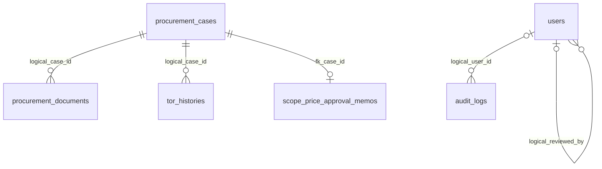

# ฐานข้อมูล TOR SKP v1.1.0 — canonical baseline

## สถานะอ้างอิง 24 พฤศจิกายน 2569

ตรวจ main `6c6ed8e01bc78049a4a264c696dca6665a2e5022` (docs handoff หลัง release v1.1.0) เทียบกับ export Dev จาก phpMyAdmin 5.2.3, MySQL 8.4.3, PHP 8.3.30 วันที่ 24 พ.ย. 2569. Export เป็นข้อมูลส่วนตัว ไม่อยู่ใน deliverable. `database/schema.sql` ใหม่สกัดเฉพาะ CREATE/ALTER ส่วนโครงสร้าง 12 ตาราง 100 คอลัมน์ แล้วรวม PK/index/auto-increment/FK ใน CREATE TABLE; ไม่มีข้อมูลจริง ไม่มี seed บัญชีหรือรายชื่อ ไม่มี DROP และไม่กำหนดหมายเลข auto-increment จากฐานจริง. สะท้อน Dev ที่ export มา ไม่ใช่การอ้างว่า Production เหมือนกัน. ยังไม่ได้รัน import ใน MySQL/MariaDB จริงในสภาพแวดล้อมของผู้ช่วย.

**ใช้ schema.sql เฉพาะฐานใหม่ว่างเท่านั้น. ฐาน Dev/Production ที่ทำงานอยู่ ห้าม import ทับ.** ให้รัน checks แบบ read-only แล้วเปลี่ยนเฉพาะสิ่งที่ขาด. ดู [DATABASE_BACKUP.md](DATABASE_BACKUP.md) สำหรับการเก็บสำรองและเอา dump ออกจาก Git.

## ตารางและสัญญาข้อมูล

| Table | ความหมาย / key ใน Dev |
|---|---|
| `users` | id PK, username unique, full_name/department/password_hash/role/account_status/must_change_password/reviewed_by/reviewed_at, status+created index |
| `login_attempts` | PK identifier_hash+ip_address, attempts/locked_until, throttle |
| `audit_logs` | id PK, user_id nullable (logical link), event_type/IP/details_json/timestamp, indexes |
| `medicines` | id PK, name unique, unit/specification |
| `medicine_price_references` | id PK, unique medicine_name+dosage_form_strength+unit, decimal(15,4), source_file |
| `committee_sets` | id PK, title unique, chair/member 1/2 name/position |
| `price_source_drafts` | id PK, title/content |
| `document_signer_defaults` | document_type PK, proposer/approver name/position |
| `procurement_cases` | id PK, supplier_name, title, fiscal_year/plan/budget/network, memo suffix/date, signers, items_json/committee_json; Dev ไม่มี unique บนเลข+วันที่ |
| `procurement_documents` | id PK, unique case_id+document_type, memo/date/extra_json |
| `tor_histories` | id PK, nullable case_id index, title/committee_json/items_json/price_source/timestamps |
| `scope_price_approval_memos` | id PK, case_id unique, FK case ON DELETE CASCADE, memo/date/data_json |



มี FK จริงเพียง `fk_scope_price_approval_case`; เส้นอื่นคือความสัมพันธ์ใน application. `case_id` เป็นหน่วยชุดจัดซื้อ ไม่ใช่ supplier. `extra_json.history_id` อ้าง snapshot TOR และต้องอยู่ case เดียวกัน. `saveProcurementDocument()` ใช้ upsert บน unique case+type และแทน JSON ทั้งก้อน; caller ต้องรักษา keys เดิม. ข้อ 7 price_basis, allocated_budget, revision/year และค่าเพิ่มเติม TOR อยู่ใน JSON; ไม่เพิ่ม column ถ้าไม่จำเป็น. Scope ขั้น 4 อยู่ตารางแยก. ลำดับ 1 หลักการ, 2 เชิญกรรมการ, 3 TOR, 4 อนุมัติคุณลักษณะ/ราคา, 5 รายงานผล, 6 รายงานประชุม.

## ความแตกต่างจาก schema เก่า

| รายการ | Git schema ก่อนแก้ | Dev export / baseline ใหม่ |
|---|---|---|
| จำนวนตาราง | 11 | 12 รวม scope_price_approval_memos |
| supplier_name | ไม่มี | varchar(255) NOT NULL DEFAULT '' |
| users profile/status/review | ไม่มี | ครบตาม registration approval |
| JSON | native JSON | LONGTEXT (บางคอลัมน์ utf8mb4_bin); PHP encode/decode เดิม |
| CHECK document_type | อนุญาต 4 type ไม่รวมรายงานผล | ไม่มี CHECK; มีข้อมูล 5 types จริง |
| FK | audit→users, documents→case, histories→case | มีเฉพาะ scope→case |
| unique เลขหลักการ+วันที่ | มี | ไม่มีใน Dev |
| CHECK role/password flag/price/signer | มี | ไม่มีใน Dev |
| seed / DROP / auto increment snapshot | มี | ไม่มีใน schema ใหม่ |

**ไม่ใช่คำสั่งให้ถอด FK/CHECK/unique จากฐานที่มีอยู่.** schema ใหม่รักษาโครงสร้าง Dev ที่ผู้ใช้ export มาเพื่อไม่เสี่ยงเปลี่ยนพฤติกรรม; ข้อจำกัดด้าน integrity ที่หายไปเป็นหนี้ด้านความปลอดภัย/คุณภาพข้อมูล ต้องออกแบบ migration แยก ทดสอบ cascade/delete, concurrency, JSON และฐานเป้าหมายจริงก่อนใช้. อย่าคืน constraints เก่าทั้งชุดโดยไม่ตรวจ โดยเฉพาะ document_type และ unique เลขหลักการ.

## ผลตรวจ dump แบบ offline (ไม่เปิดเผยข้อมูลรายบุคคล)

| ตาราง | จำนวน rows |
|---|---:|
| audit_logs | 78 |
| committee_sets | 2 |
| document_signer_defaults | 1 |
| login_attempts | 4 |
| medicines | 234 |
| medicine_price_references | 2,520 |
| price_source_drafts | 1 |
| procurement_cases | 17 |
| procurement_documents | 68 |
| scope_price_approval_memos | 2 |
| tor_histories | 17 |
| users | 4 |

ตรวจ statement INSERT ครบ 24 ชุดด้วยตัวแยก SQL ที่รองรับ quote/escape; ทุก JSON ที่ไม่เป็น NULL ใน 7 คอลัมน์อ่านได้; ไม่พบ orphan case/user/review link, duplicate เลขหลักการ+วันที่หรือ case+type หรือ scope case, ราคากลางติดลบ; TOR 17 รายการมี history_id ตรง snapshot และ case เดียวกันทั้งหมด. จำนวนเอกสารแต่ละขั้นต่างกันตามการบันทึกจริง ไม่ตีความว่าเป็นข้อมูลหาย. ผลนี้เป็น snapshot ไม่ใช่การรับรองฐานปัจจุบันหลัง export หรือการทดสอบ engine.

## ติดตั้งฐานใหม่ (ไม่ใช้ข้อมูลจริงจาก Git)

1. สร้างฐาน **ใหม่ว่าง** ด้วย utf8mb4 / utf8mb4_unicode_ci; เลือกฐานให้ถูกใน phpMyAdmin. Import `database/schema.sql` ครั้งเดียว. ไม่ต้องรัน migration เก่าซ้ำหลัง schema ใหม่.
2. ตั้ง `TOR_DB_HOST`, `TOR_DB_NAME`, `TOR_DB_USER`, `TOR_DB_PASS` ให้ชี้ฐานทดสอบหรือฐานใหม่. `core/config.php` ใช้ PDO และ requireDatabaseTables ตรวจเพียงว่าตารางมีอยู่ ไม่ตรวจคอลัมน์.
3. รัน schema check แล้ว integrity check. ต้องไม่มี missing columns; ตรวจ PK/unique/FK ด้วย. ต้องมี approved admin ก่อนใช้งานระบบ: ไม่มีรหัสผ่านเริ่มต้นใน schema. บนฐานใหม่ที่ยืนยันว่าไม่มีบัญชีเดิม ให้สมัครบัญชีจริงผ่าน register.php (จะ pending) แล้วผู้ดูแลฐานที่ได้รับอนุญาตตรวจชื่อบัญชีที่เพิ่งสมัครและปรับเฉพาะบัญชีนั้นเป็น role=admin, account_status=approved, reviewed_at=NOW() ใน phpMyAdmin; ห้ามแก้ password_hash หรือเปิด approve ทุกคน. หากมี approved admin อยู่แล้ว ใช้ระบบจัดการบัญชีตามปกติเท่านั้น. ตั้งค่าชุดกรรมการ ยา ราคากลางและผู้ลงนามผ่าน UI หรือ import ข้อมูลที่ได้รับอนุญาตแบบ private.
4. ทดสอบ login/admin approval, สร้างชุดใหม่, save/reload ทุกขั้น, TOR price modes, export Word/PDF/merge V4. ฐานใหม่ยังไม่มี master data จึงไม่ใช่ full restore.

## ฐานเดิม / Migration inventory

| ไฟล์ | ใช้เมื่อ |
|---|---|
| `20260821_security_hardening.sql` | migration เก่าก่อน v1.1.0; มี ALTER, UPDATE, CHECK รุ่นเก่าและสร้าง table; **ห้ามรันซ้ำหรือใช้เป็น migration รวม** |
| `20260821_document_signer_defaults.sql` | ค่า default ผู้ลงนามรุ่นเก่า; ไม่ต้องรันบน Dev/schema ใหม่; มีข้อมูล seed รุ่นเก่า |
| `20261124_registration_approval.sql` | เพิ่ม 5 คอลัมน์ profile/status/review และ index; ใช้เฉพาะฐานเก่าที่ขาดครบชุด ไม่รันถ้ามีบางส่วน ต้องทำ diff เฉพาะจุด |
| `20261124_scope_price_approval_memos.sql` | สร้างตารางขั้น 4 เมื่อยังไม่มี (CREATE IF NOT EXISTS); ตรวจ FK/unique หากมีแล้ว |
| `20261124_procurement_case_supplier.sql` | เพิ่ม supplier_name หากไม่มี; migration ที่เคยส่งให้ผู้ใช้ก่อนหน้า ตอนนี้นำเข้า repo candidate; Dev มีแล้ว ไม่ต้องรัน |

ฐาน Dev ที่ส่งมามีคอลัมน์และตารางครบ ไม่ต้อง migrate. Production หรือฐานเก่าให้ตรวจจริงก่อน. ถ้าฐาน MySQL 8.4 ยังมี **CHECK เดิมชื่อ chk_procurement_documents_document_type ที่อนุญาตเพียง 4 type** ให้ตรวจ SHOW CREATE TABLE และทดลองบน copy. หากยืนยันว่าต้องรองรับขั้น 5 ให้แก้เฉพาะ CHECK นั้นโดยเพิ่ม `committee_scope_result_memo` เข้า allowlist เดิม (scope ขั้น 4 อยู่ store แยก). ตัวอย่าง SQL สำหรับ MySQL เท่านั้น หลังตรวจและอนุมัติ:

```sql
ALTER TABLE procurement_documents
  DROP CHECK chk_procurement_documents_document_type,
  ADD CONSTRAINT chk_procurement_documents_document_type CHECK
    (document_type IN ('principle_approval','committee_scope_invitation','meeting_report','tor_company_purchase','committee_scope_result_memo'));
```

ห้ามรันถ้าไม่มี CHECK นี้หรือ expression ต่างจากที่กล่าว; MariaDB syntax/version ต้องตรวจแยก. ไม่เปลี่ยนฐาน Dev ด้วยคำสั่งนี้. ไม่ปิด FOREIGN_KEY_CHECKS เพื่อกลบ error. ไม่รันทุก migration ตามชื่อไฟล์โดยอัตโนมัติ.

## ตรวจฐานแบบ read-only

- `database/checks/v1.1.0_schema_check.sql`: DB/version, missing 100 required columns, รายการ actual type/default, indexes, constraints; อ่าน metadata ได้แม้ตารางขาด.
- `database/checks/v1.1.0_integrity_check.sql`: รันเมื่อ schema gate ครบเท่านั้น; จำนวน rows, duplicate/orphan, JSON validity, TOR history link, status/price; ไม่แสดงค่า JSON/ชื่อ/IP/hash จริง.
- เปรียบเทียบจำนวน rows ก่อน/หลัง migration บน copy; ไม่ใช้ row counts เป็นหลักฐานความครบถ้วนเพียงอย่างเดียว. Backup แบบ full data เก็บแยก; ทดสอบ restore ก่อน deploy.

## Import v1.2.0 candidate

ไม่มี migration เพิ่ม; ใช้ `medicines` unique(name) และ `medicine_price_references` unique(medicine_name,dosage_form_strength,unit), collation utf8mb4_unicode_ci, InnoDB. Preview ไม่เขียนตารางจริง. Confirm ตรวจ fingerprint และล็อก target table range ใน transaction (REPEATABLE READ); บันทึกหลายแถวต่อ statement และ rollback เมื่อเกิด exception ก่อน commit. Replace ราคาใช้ DELETE เฉพาะ ID ที่ไม่อยู่ในชุดใหม่ ไม่ใช้ TRUNCATE และไม่ reset AUTO_INCREMENT. ห้ามแก้ schema ให้ผ่าน validation โดยพลการ. ดู [IMPORT_SYSTEM.md](IMPORT_SYSTEM.md) และทดสอบบนฐาน Dev จริงก่อนขึ้น Hosting.

การล้างราคากลางประจำปีจาก Admin เป็นคำสั่ง DELETE เฉพาะ `medicine_price_references` หลังรับทราบ backup/คำยืนยัน และตรวจ count/hash ภายใต้ lock; transaction เดียว ไม่ TRUNCATE ไม่ reset ID ไม่แก้ schema. หากพบ inbound FK จะไม่ล้าง. การล้างไม่ใช่ migration; ห้ามใช้กับตาราง medicines หรือเอกสาร.


### การล้างคลัง `medicines` ใน v1.2.0
ไม่เปลี่ยน schema: ใช้ `core/medicine_catalog_tools.php` ตรวจ snapshot และ block การล้างเมื่อมีข้อมูลใน procurement_cases, procurement_documents, tor_histories หรือ scope_price_approval_memos เนื่องจากฟอร์ม TOR ยังอ้างอิง ID ใน `medicines`. ไม่ลบตารางเอกสาร ไม่ reset AUTO_INCREMENT และไม่แตะ `medicine_price_references`. หากมีเอกสารเดิมให้ใช้ import merge; Excel export ไม่เก็บ ID จึงไม่ใช่ตัวแทน full SQL backup. ทำการล้างเฉพาะฐานใหม่ที่ยังไม่มีเอกสาร และไม่มีฟอร์ม/ผู้ใช้ทำรายการค้าง.
