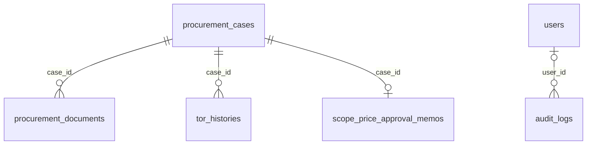

# ฐานข้อมูลและ Migration — อ่านก่อนแก้ DB

## สถานะและหลักปฏิบัติ

MySQL/MariaDB ผ่าน PDO, utf8mb4_unicode_ci. DB fallback ใน core/config.php สำหรับ Laragon คือ `if0_40414720_tor_skp`; production กำหนดผ่าน environment. ไม่เก็บรหัสผ่านจริงในเอกสาร. `requireDatabaseTables()` ตรวจ table มีอยู่เท่านั้น ไม่ตรวจ columns/constraints. **schema.sql ที่ commit อยู่ยังเก่ากว่า code v1.1.0**; ฐานที่ผู้ใช้กำลังใช้งานอาจมีการ ALTER นอก Git. ห้ามทึกทักว่า schema จาก dump เก่าตรงกับฐานจริง.

## ตาราง

| Table | ความหมาย / key |
|---|---|
| `users` | id, username unique, password_hash, role admin/editor, must_change_password, status/profile เพิ่มโดย migration |
| `login_attempts` | identifier_hash/IP, attempts/locked_until สำหรับ throttle |
| `audit_logs` | user_id nullable FK, event_type, IP, details_json, timestamp |
| `medicines` | master ยา name unique, unit, specification |
| `medicine_price_references` | ราคากลางตาม medicine_name+dosage_form_strength+unit unique, decimal(15,4), source_file |
| `committee_sets` | title unique, chair/member 1/2 name และ position |
| `price_source_drafts` | title/content ข้อความแหล่งราคากลาง |
| `document_signer_defaults` | document_type (หลักการ), ผู้เสนอ/ผู้อนุมัติและตำแหน่ง |
| `procurement_cases` | id, title, supplier_name (ต้องมี), fiscal_year/plan/budget/network, เลขและวันที่หลักการ, signers, items_json, committee_json; unique memo suffix + date |
| `procurement_documents` | case_id + document_type unique, memo_no_suffix, doc_date, extra_json; FK case ON DELETE CASCADE |
| `tor_histories` | id, case_id nullable FK, title, committee_json, items_json, price_source, timestamps; snapshot TOR |
| `scope_price_approval_memos` | id, case_id unique FK cascade, memo suffix/date, data_json LONGTEXT; เพิ่มโดย migration |

## ความสัมพันธ์



`extra_json.history_id` อ้าง tor_histories.id ตามตรรกะโปรแกรม (ไม่ใช่ FK ใน JSON). รักษา JSON keys ที่ไม่รู้จักเมื่อ update. `saveProcurementDocument()` เป็น upsert ที่แทน extra_json ทั้งก้อน; caller จึงต้อง merge ค่าเก่าที่จำเป็น. TOR เก็บ 5 keys ตาม WORKFLOW. ไม่เพิ่ม table/column เพียงเพราะเพิ่ม option ที่เก็บใน JSON ได้. Scope ขั้น 4 ใช้ store แยก ไม่ย้ายลง document_type โดยพลการ.

## Migration inventory

| ไฟล์ | สิ่งที่ทำ | สถานะ |
|---|---|---|
| `database/migrations/20260821_security_hardening.sql` | charset, JSON, role, constraints, throttling/audit | อยู่ Git; มี ALTER ADD constraint จึงไม่รับรอง rerun ทุกฐาน |
| `20260821_document_signer_defaults.sql` | ค่าเริ่มต้น signer/approver | อยู่ Git; ตรวจ table ก่อนใช้ |
| `20261124_registration_approval.sql` | full_name, department, account_status enum pending/approved/rejected/disabled, reviewed_by/at, index | อยู่ Git; run once, existing default approved |
| `20261124_scope_price_approval_memos.sql` | สร้าง table แยกขั้น 4, case unique FK | อยู่ Git; CREATE IF NOT EXISTS |
| `20261124_procurement_case_supplier.sql` | เพิ่ม supplier_name VARCHAR(255) NOT NULL DEFAULT '' หลัง title แบบตรวจ existence | **เคยส่งมอบให้ผู้ใช้แยก แต่ยังไม่พบใน main ณ baseline**; ควร commit แยกหลังยืนยันไฟล์จริง ไม่สร้างคอลัมน์ซ้ำ |

## Schema drift ที่ยืนยันจากไฟล์ Git

1. `schema.sql` ยังไม่มี `procurement_cases.supplier_name` ทั้งที่ `procurementCases()` SELECT คอลัมน์นี้ และ save case เขียนคอลัมน์นี้. ฐานใหม่จะเกิด unknown column หากไม่เพิ่ม.
2. `schema.sql` ไม่มี users profile/status/review columns และไม่มี scope_price_approval_memos; ต้องอาศัย migrations ข้างต้นตามสถานะจริง.
3. CHECK `chk_procurement_documents_document_type` ใน schema.sql และ security_hardening เดิมอนุญาตเพียง principle_approval, committee_scope_invitation, meeting_report, tor_company_purchase. Code v1.1.0 เขียน `committee_scope_result_memo` ด้วย. ฐานที่บังคับ CHECK อาจบันทึกขั้น 5 ไม่ได้. Dump Laragon มี row ขั้น 5 จึงต้องตรวจ constraint จริง ไม่สรุปว่า schema กับ dump เหมือนกัน. ควรวางแผน migration เฉพาะ constraint หลังทราบ MySQL/MariaDB version และ backup; ไม่ปิด constraint ทั้งหมด.
4. README เก่าเคยบอก migration สองตัว rerun ได้ แต่มี ALTER ADD constraint; อย่าเชื่อว่า rerun ปลอดภัยโดยไม่ตรวจ. schema.sql มี FK/constraints หลายตัวอยู่แล้ว.
5. `database/backup-laragon-if0_40414720_tor_skp.sql` และ `database/tor_skp-full-localhost-ready-for-import-25690821-163909.sql` เป็น dump ที่ track อยู่ ไม่ใช่ migration. อาจมีข้อมูลจริง/บัญชี/ประวัติ ห้ามนำไปเผยแพร่หรือใช้ทับฐานที่ใช้งานโดยอัตโนมัติ. ตรวจเฉพาะ DDL บนเครื่องปลอดภัย; ไม่คัดลอก INSERT ลง docs.

## ตรวจฐานก่อน deploy (read-only)

รันด้วยบัญชีที่ได้รับอนุญาตในฐานเป้าหมาย ไม่แสดงข้อมูลผู้ใช้จริง:

```sql
SELECT DATABASE(), VERSION();
SHOW TABLES;
SHOW CREATE TABLE procurement_cases;
SHOW CREATE TABLE procurement_documents;
SHOW CREATE TABLE tor_histories;
SHOW CREATE TABLE users;
SHOW CREATE TABLE scope_price_approval_memos;
SHOW COLUMNS FROM procurement_cases LIKE 'supplier_name';
SHOW COLUMNS FROM users LIKE 'account_status';
```

สำรองฐานนอก web root; clone ไปฐานทดสอบ; ตรวจ missing tables/columns/constraint; เตรียม migration เฉพาะที่ขาดและทดลองกับ DB engine จริง; ตรวจจำนวน case/document/history ก่อนหลังโดยไม่เผยข้อมูล; ทดสอบ case เก่า + ใหม่ครบ 6 ขั้น; deploy หลังอนุมัติ. ไม่ reimport SQL dump เพื่อแก้บั๊ก UI. รอบเอกสารนี้ไม่ได้รัน SQL และไม่ได้แก้ schema.
